# Gallery

Images produced with the Surface Observatory pipeline. Click any image to open
it at full size.

> **Read these with the [research status](RESEARCH_STATUS.md) in mind.** The
> London results in panels 4–6 come from a pipeline **retrained locally on
> London only** (Landsat days from 2021 and 2023–24, 38 inputs). They are not
> scores for the live global model. The ≤3 °C goal across regions and
> day/night conditions has **not** been demonstrated.

## Highlights

<table>
  <tr>
    <td width="50%" valign="top">
      <a href="gallery/01-london-heat-island.png">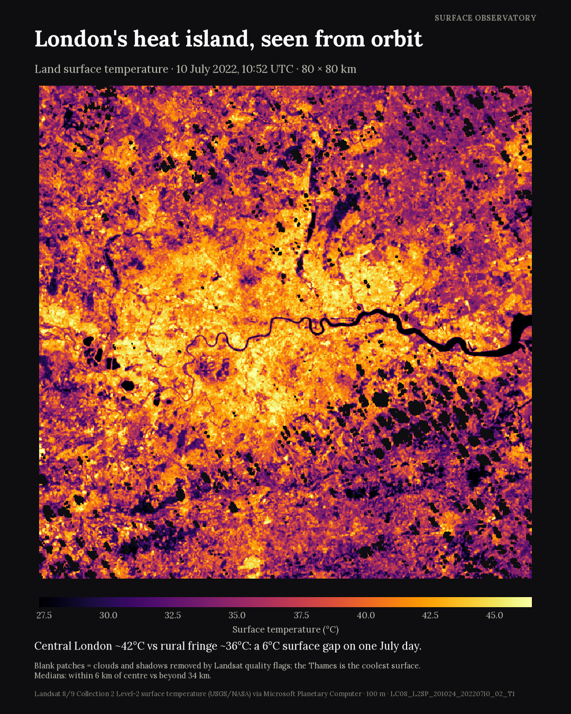</a>
      
<b>London's heat island, seen from orbit</b> 
      Landsat surface temperature, 10 July 2022, 80 × 80 km. Central London is
      about 42 °C against about 36 °C on the rural fringe, a 6 °C surface gap.

    </td>
    <td width="50%" valign="top">
      <a href="gallery/02-six-landscapes.png">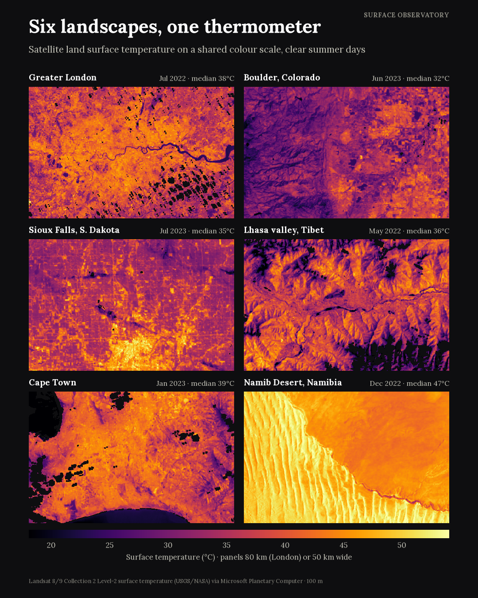</a>
      
<b>Six landscapes, one thermometer</b> 
      Greater London, Boulder, Sioux Falls, Lhasa, Cape Town and the Namib
      Desert, all on a shared colour scale.

    </td>
  </tr>
  <tr>
    <td width="50%" valign="top">
      <a href="gallery/03-research-evidence.png">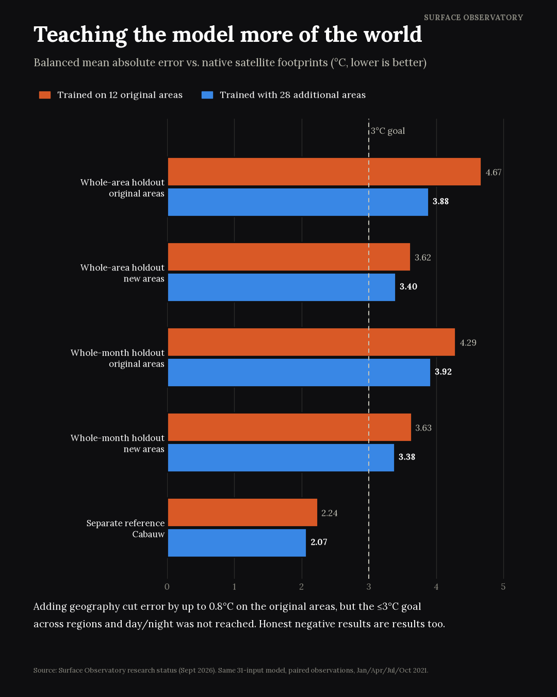</a>
      
<b>Teaching the model more of the world</b> 
      Adding 28 training areas cut the error by up to 0.8 °C on the original
      areas. The ≤3 °C goal was still not reached.

    </td>
    <td width="50%" valign="top">
      <a href="gallery/04-heldout-heatwave.png">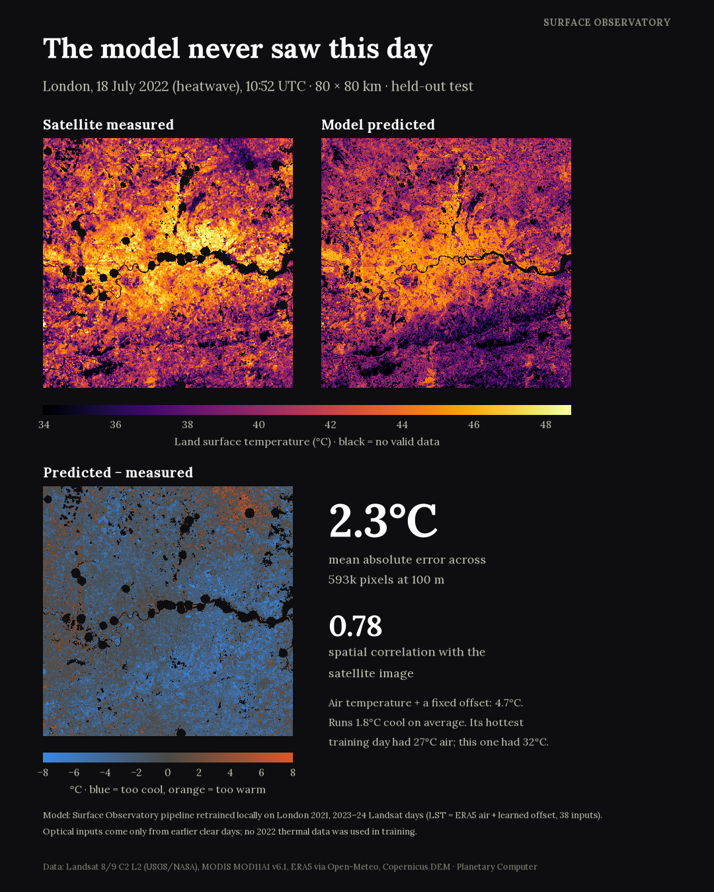</a>
      
<b>The model never saw this day</b> 
      London, 18 July 2022 (heatwave), held out from training. Mean absolute
      error 2.3 °C (London-only model). An air temperature plus fixed offset
      baseline gives 4.7 °C.

    </td>
  </tr>
  <tr>
    <td width="50%" valign="top">
      <a href="gallery/05-unobserved-day.png">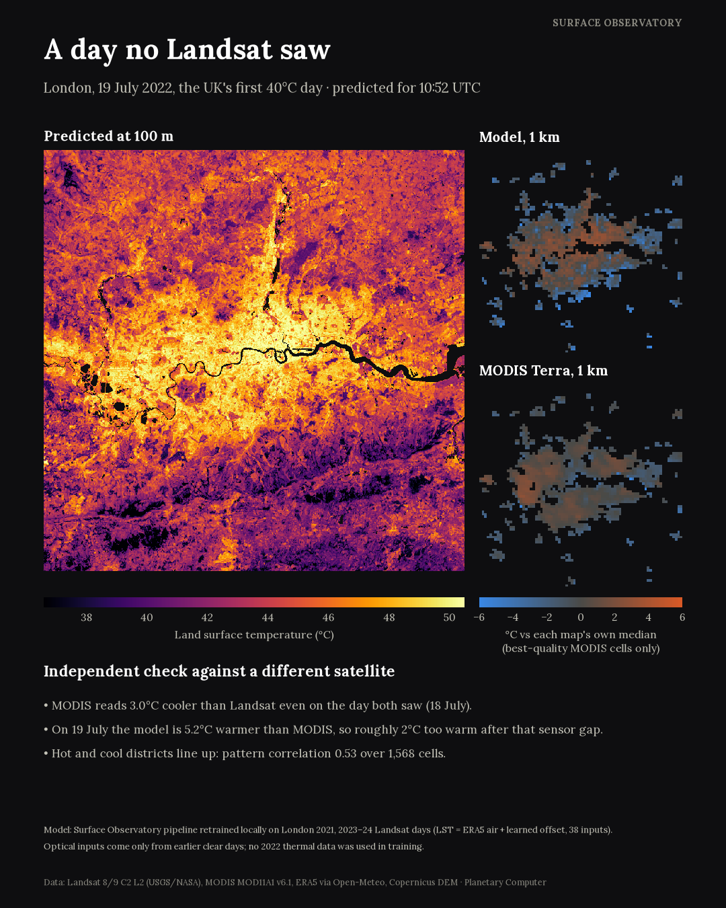</a>
      
<b>A day no Landsat saw</b> 
      19 July 2022, the UK's first 40 °C day, predicted at 100 m and checked
      against MODIS Terra at 1 km. The model reads about 2 °C too warm once
      the sensor gap is allowed for.

    </td>
    <td width="50%" valign="top">
      <a href="gallery/06-all-heldout-days.png">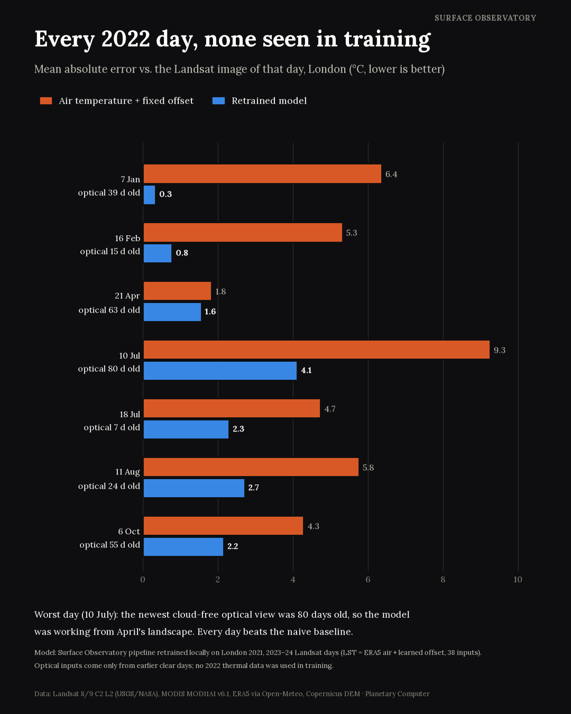</a>
      
<b>Every 2022 day, none seen in training</b> 
      Seven held-out London days. The retrained model beats the naive
      baseline every time. It does worst when its newest clear optical view
      is old (80 days on 10 July).

    </td>
  </tr>
</table>

## Land surface temperature maps

Landsat 8/9 Collection 2 Level-2 surface temperature (USGS/NASA) via Microsoft
Planetary Computer. Each map covers 384 × 216 km at 100 m per pixel. Colour map
inferno (dark = cool, yellow = hot); dark grey = no clear observation.

These are the **balanced** mosaics, shown here downscaled to 1920 × 1080. Each
extra pass is shifted by its median difference from neighbouring passes to
hide seams, so values far from the main pass are adjusted. Use the raw
mosaics for numbers. The original 3840 × 2160 PNGs are not stored in the
repository because of their size. Each map has a `.json` file next to it with
the projection, extent, Landsat scene IDs and per-pass offsets.

<table>
  <tr>
    <td width="50%" valign="top">
      <a href="gallery/maps/greater-london-lst-balanced-1920.jpg">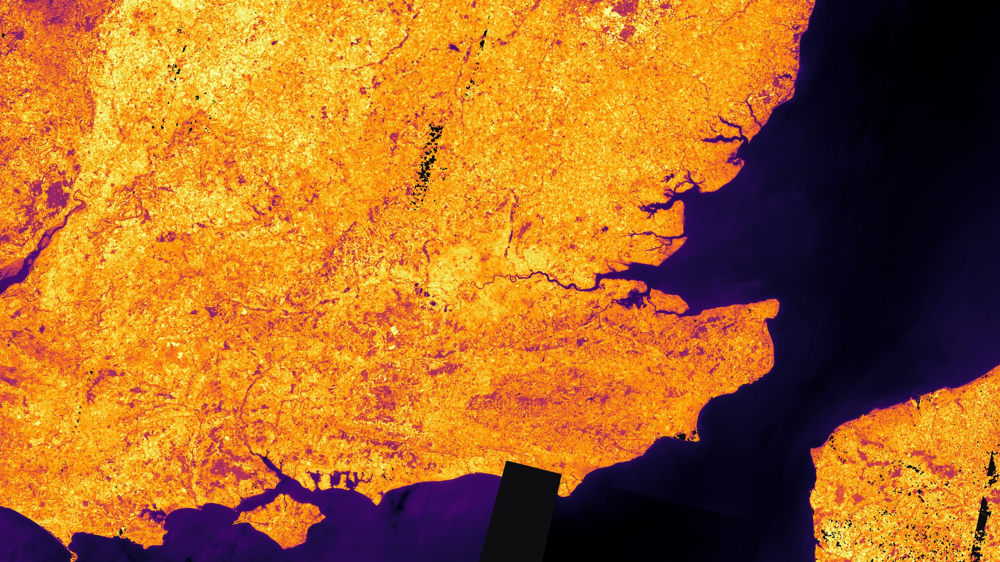</a>
      
<b>Greater London and rural fringe</b> 
      11 Aug 2022 · 98.5% covered · 18.9 to 45.8 °C ·
      <a href="gallery/maps/greater-london-lst.json">metadata</a>

    </td>
    <td width="50%" valign="top">
      <a href="gallery/maps/boulder-lst-balanced-1920.jpg">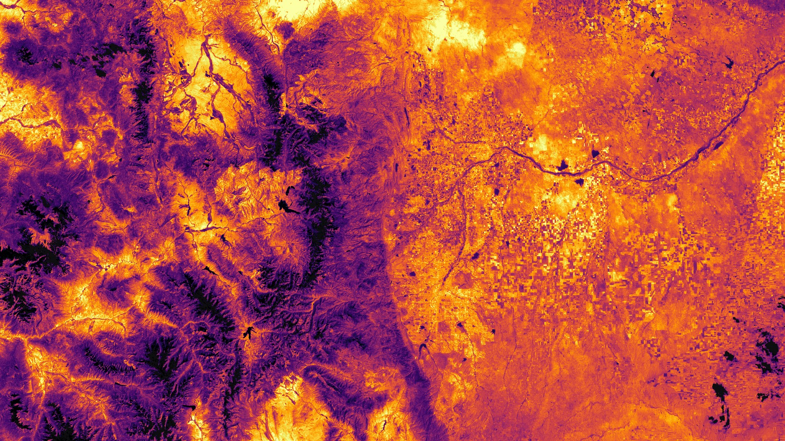</a>
      
<b>Boulder and Table Mountain</b> 
      25 Jun 2023 · 98.3% covered · 17.4 to 48.2 °C ·
      <a href="gallery/maps/boulder-lst.json">metadata</a>

    </td>
  </tr>
  <tr>
    <td width="50%" valign="top">
      <a href="gallery/maps/sioux-falls-lst-balanced-1920.jpg">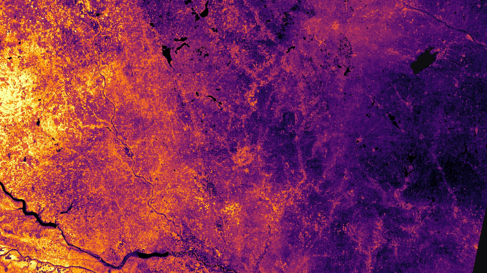</a>
      
<b>Sioux Falls and agricultural surroundings</b> 
      8 Sep 2022 · 99.3% covered · 25.4 to 46.2 °C ·
      <a href="gallery/maps/sioux-falls-lst.json">metadata</a>

    </td>
    <td width="50%" valign="top">
      <a href="gallery/maps/lhasa-lst-balanced-1920.jpg">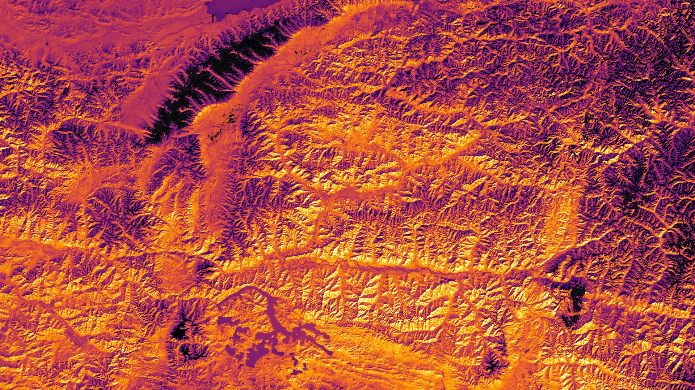</a>
      
<b>Lhasa valley and adjacent high terrain</b> 
      14 Dec 2024 · 97.5% covered · −12.6 to 28.3 °C ·
      <a href="gallery/maps/lhasa-lst.json">metadata</a>

    </td>
  </tr>
  <tr>
    <td width="50%" valign="top">
      <a href="gallery/maps/cape-town-lst-balanced-1920.jpg">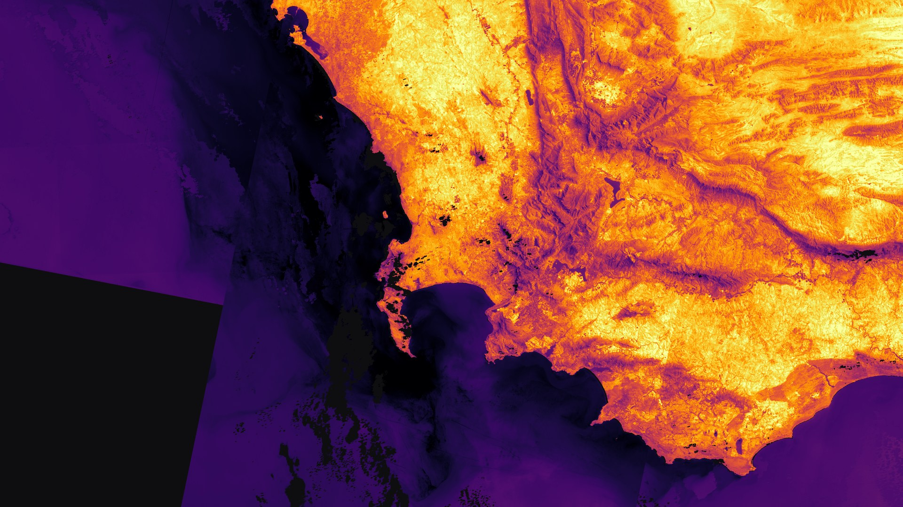</a>
      
<b>Cape Town and Stellenbosch fringe</b> 
      20 Jan 2023 · 87.6% covered · 15.7 to 51.3 °C ·
      <a href="gallery/maps/cape-town-lst.json">metadata</a>

    </td>
    <td width="50%" valign="top">
      <a href="gallery/maps/gobabeb-lst-balanced-1920.jpg">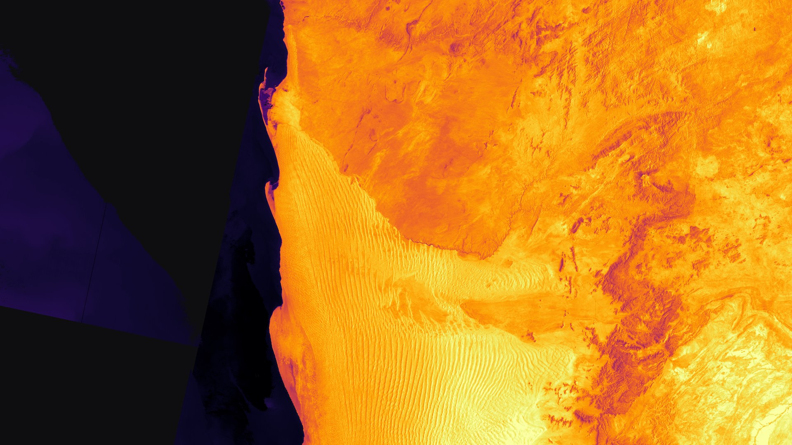</a>
      
<b>Gobabeb and Namib gravel plains</b> 
      7 Dec 2022 · 79.4% covered · 11.8 to 58.3 °C ·
      <a href="gallery/maps/gobabeb-lst.json">metadata</a>

    </td>
  </tr>
</table>

Data: Landsat 8/9 Collection 2 Level-2 (USGS/NASA), MODIS MOD11A1 v6.1, ERA5
via Open-Meteo and Copernicus DEM, accessed through Microsoft Planetary
Computer. See [third-party notices](../THIRD_PARTY_NOTICES.md) for attribution.
